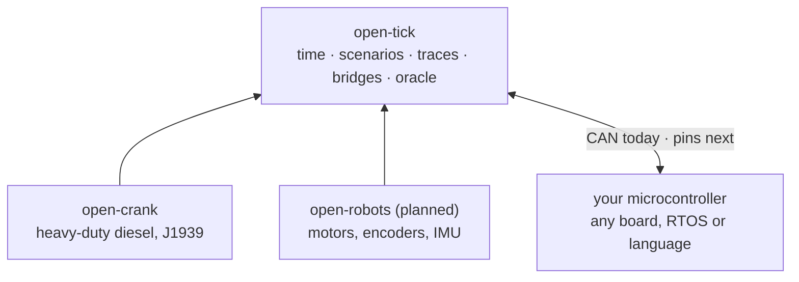

  <picture>
    <source media="(prefers-color-scheme: dark)" srcset="banner-dark.svg">
    <source media="(prefers-color-scheme: light)" srcset="banner-light.svg">
    
  </picture>

<b>Open tools to practise and develop embedded control for machines you cannot keep at home, starting with heavy machinery.</b>

  <a href="https://open-heavy-machinery.github.io">Website</a> ·
  <a href="https://github.com/Open-Heavy-Machinery/open-tick">open-tick</a> ·
  <a href="https://github.com/Open-Heavy-Machinery/open-crank">open-crank</a> ·
  <a href="https://github.com/Open-Heavy-Machinery/open-rig">open-rig</a> ·
  Apache-2.0 · pre-alpha

---

## How it started

I wanted to practise writing firmware for critical infrastructure the way it is really written: an STM32G431KB as the engine ECU of a Liebherr D936 and of a Mitsui MAN B&W 9S50ME, using every peripheral I wanted, against engines that answer back. Neither engine fits in an 8 m² apartment in Tokyo.

So I wrote the engine instead. [open-crank](https://github.com/Open-Heavy-Machinery/open-crank) is a heavy-duty diesel that speaks J1939, with an engine ECU that has opinions and a plant that never cheats. Writing it meant writing everything around it as well:

- a clock that never reads the wall;
- scenarios as data;
- a bench that grades firmware by its frames;
- tests that can fail.

None of that cares whether the machine is a crane, a robot with four motors or a set of train doors. To the microcontroller it is all voltages on pins and frames on a bus. That part became [open-tick](https://github.com/Open-Heavy-Machinery/open-tick), the core every project here is built on.

The engines still do not fit in the apartment. The G431 no longer needs them to.

— [deivideich](https://github.com/deivideich), founder

## What we are building

To a microcontroller, the world is voltages on pins, edges with timing and frames on a bus. We are building that world in the open:

- **Plants that answer back.** Physics that never quietly helps the controller under test.
- **A core that keeps time.** It carries signals to real silicon, over a bus today and on the pins next.
- **A written statement of how faithful it is.** Each machine declares what it needs, each bridge declares what it guarantees, and a run that cannot be faithful is refused instead of passing quietly *(planned)*.

The goal: anyone with a cheap board can practise on machines they will never keep at home, and teams reach the real machine with code that has already felt a load.

## Projects

**open-crank is the priority.** open-tick grows only when open-crank needs it; sibling applications such as open-robots come later.

| Project | What it is | Status |
|---|---|---|
| [**open-tick**](https://github.com/Open-Heavy-Machinery/open-tick) | The beat a simulated machine keeps: one clock, scenarios as data, traces, CAN and CAN FD bridges, and an oracle that grades a controller by the frames it sends, in C11. A pin-level bridge on a Tang Nano 20K comes with open-crank's Level 2; a Raspberry Pi Pico bridge comes when open-robots starts. | v0.2 done |
| [**open-crank**](https://github.com/Open-Heavy-Machinery/open-crank) | A heavy-duty diesel that answers back over J1939: plant, simulated engine ECU, hydraulic load and a reference controller that runs on an STM32G431 board over a real CAN bus, and an acceptance suite that grades any controller by its CAN frames. One command builds, programs and tests the board, so you can [check your own bench](https://github.com/Open-Heavy-Machinery/open-crank#run-the-demo-on-a-real-board). | v0.2.2 done, runs on open-tick |
| [**open-rig**](https://github.com/Open-Heavy-Machinery/open-rig) | A static browser viewer for open-tick traces: one trace, or two on the same time axis, with a layout from the application. | v0.1 |
| **open-robots** | DC motors, encoders and IMUs for robots, on open-tick, with no J1939. | future, after open-crank |

## How we work

- **The plant answers honestly.** Physics in the plant, decisions in a separate ECU. If the engine stays alive, your controller kept it alive.
- **The same source runs on a laptop and on a board.** The reference controller builds for a Cortex-M4F on every push; a stray `printf` or `double` fails the build.
- **Tests that can fail.** CI breaks each safety behaviour on purpose and requires the tests to notice. Refactors are checked by comparing every scenario's trace, byte for byte.
- **Every number has a source.** Parameters are marked as sourced, estimated or inherited. Representative, never presented as calibrated.
- **Generality is earned.** open-tick was extracted from open-crank only when all six of open-crank's scenarios still produced byte-identical traces.
- **No claim stronger than the code.** Anything that does not exist yet is marked *planned*.

## Get involved

Pre-alpha, and the right moment to shape it. A well-argued issue is worth more than a pull request right now.

- **Source a parameter.** Do you have bench access to a D936-class or MAN B&W-class engine? Correct a number in open-crank's [parameters.md](https://github.com/Open-Heavy-Machinery/open-crank/blob/main/docs/parameters.md) and cite where it comes from.
- **Check a layout.** Own a copy of SAE J1939-71? Compare it with the [bus interface](https://github.com/Open-Heavy-Machinery/open-crank/blob/main/docs/bus-interface.md).
- **Bring a controller.** Point your own firmware at the simulated engine and tell us what broke.
- **Name the next machine.** Cranes, robots, trains, gensets: open an issue on [open-tick](https://github.com/Open-Heavy-Machinery/open-tick/issues) with the machine you would practise on and the signals its controller sees.

## Safety

These are tools for practice, development and regression testing. They are not certified, and they are never to be connected to real machinery.

Apache-2.0. Not affiliated with Liebherr, MAN Energy Solutions or Mitsui E&S; engine designations are used nominatively to identify the class of engine being modelled. SAE J1939 is a paywalled standard; no specification text is redistributed.
